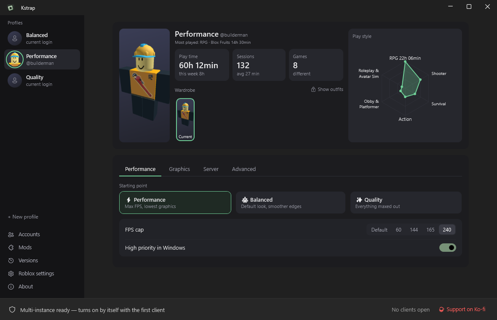
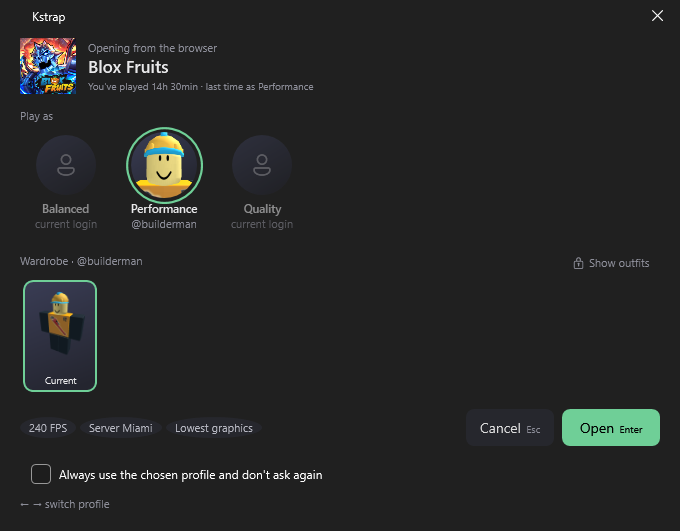

# Kstrap

**A profile-based Roblox launcher for Windows.**
Every profile has its own account, outfit, FastFlags, mods and FPS cap, and several profiles can play at the same time.

[**⬇ Download**](https://github.com/Kauan-Azevedo/Kstrap/releases/latest) · [Features](#features) · [FAQ](#faq) · [☕ Support on Ko-fi](https://ko-fi.com/kauanazevedo)

English · Português (Brasil) inside the app

## Features

- **Profiles, not settings pages.** Pick a profile on the left and everything about it is in one place: the account it signs in with, the
  outfit it wears, graphics, FPS cap, server region, mods and FastFlags. Changes save as you make them.
- **Wardrobe.** Your account's saved outfits as cards. The one you pick is worn automatically when that profile opens a game.
- **Several Roblox windows at once**, each with its own profile and account.
- **Play from the website.** Clicking *Play* on roblox.com opens a small picker: choose the profile, optionally a different outfit just for
  that match, and follow the launch step by step.
- **Play time and play style.** Hours played, sessions and games per profile, plus a hexagon of the Roblox categories you play the most.
- **Preferred server region** (e.g. São Paulo or Miami), picked automatically when a game opens without a chosen server.
- **Auto-rejoin** when Roblox disconnects you for idling or a dropped connection.
- **Ready-made templates**: ⚡ Performance, ⚖️ Balanced and ✨ Quality.
- **Safe accounts.** Logins are encrypted on your PC and protected by Windows Hello (PIN, fingerprint or face), asked once per session.
- **Stays out of the way.** Lives next to the clock, can start with Windows, and updates itself.

## Install

1. Download **`KstrapLauncher-win-Setup.exe`** from the [latest release](https://github.com/Kauan-Azevedo/Kstrap/releases/latest).
2. Run it. No administrator rights needed; it installs to `%LocalAppData%\KstrapLauncher`.
3. Windows may say **"Windows protected your PC"** because the installer isn't signed with a paid certificate.
   Click **More info → Run anyway**.

Kstrap then keeps itself up to date: it checks for new versions every few hours, downloads them in the background and installs them when
you quit (or right away from the notice in the footer).

**Requirements:** Windows 10 or 11 (64-bit). [Microsoft Edge WebView2](https://developer.microsoft.com/microsoft-edge/webview2/) for signing in
to accounts (already included in Windows 11).

## FAQ

**Is this allowed? Can I get banned?**
Kstrap only works from outside the game: it installs Roblox, writes its settings and opens it, like Bloxstrap and Froststrap do. It never
injects anything into the game or reads its memory.

**Where is my data?**
In `%LocalAppData%\Kstrap` (profiles, encrypted accounts, play time). It stays there if you uninstall, so a reinstall picks up where you left off.

**Does it change my real Roblox avatar?**
Only when a profile has an outfit set: that outfit is worn before the game opens, the same way the avatar editor would do it.

**How do I switch the language?**
*About → Language*. The first time, Kstrap follows your Windows language.

## Privacy and what Kstrap connects to

Kstrap has no servers of its own and collects no data. It only talks to:

| Service | When | What it sends |
|---|---|---|
| **Roblox** (`*.roblox.com` APIs, `*.rbxcdn.com` downloads and images, and Roblox's `s3.amazonaws.com/setup.roblox.com` mirror) | Installing Roblox, signing in, opening games, outfits, avatars, game names | What any Roblox client sends; your login only goes to Roblox |
| **roblox.com sign-in page** | Only in the *Sign in with an account* window | It's Roblox's own website, loaded in a browser window (Microsoft Edge WebView2) |
| **apis.rovalra.com** | When a profile has a preferred server region, or an AI asks for a server list through the MCP | Nothing personal: it downloads the public list of Roblox datacenter locations |
| **ipinfo.io** | When the region fallback is set to *Nearest*, or an AI asks for a server list through the MCP | Your IP address, to estimate which server is closest to you |
| **GitHub** | Every 4 hours while Kstrap is open, to check for updates | Nothing but the request for the latest release |
| **ko-fi.com** | Only if you click *Support on Ko-fi* | Opens in your browser |

Stored only on your PC, in `%LocalAppData%\Kstrap`: profiles, your accounts (encrypted and protected by Windows Hello), play time,
a cache of game names, and a log of launch steps and errors (`logs\kstrap.log`) with login cookies and tickets removed.

The **local API** (About › Local API) listens only on `localhost`, so nothing outside your PC can reach it, and you can turn it off.
The **AI integration (MCP)** does nothing until you add it to an AI tool yourself (About › AI integration). It runs only while that tool
is open and talks to it through a local pipe.

See [CHANGELOG.md](CHANGELOG.md) for what changed in each version.

## Support

Kstrap is free. If it made your Roblox life easier, you can buy me a coffee:
**[ko-fi.com/kauanazevedo](https://ko-fi.com/kauanazevedo)** ☕

Found a bug or have an idea? [Open an issue](https://github.com/Kauan-Azevedo/Kstrap/issues).

## Credits

Built on the work of [Bloxstrap](https://github.com/bloxstraplabs/bloxstrap) (MIT), [Froststrap](https://github.com/Froststrap/Froststrap)
(MPL-2.0, preset mod files), [WPF UI](https://github.com/lepoco/wpfui) (MIT), [CommunityToolkit.Mvvm](https://github.com/CommunityToolkit/dotnet) (MIT)
and [Velopack](https://github.com/velopack/velopack) (MIT). Multi-instance ideas from AMUI (MIT) and Fishstrap.

Kstrap is not affiliated with, endorsed by or connected to Roblox Corporation.
